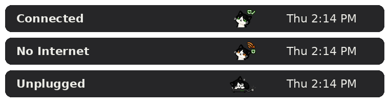

<div align="center">

# LanCat 🐈‍⬛

**맥북 메뉴바에 사는 유선랜 상태 고양이**

[English](README.md) · 한국어



</div>

macOS 메뉴바에는 와이파이 아이콘은 있는데 유선랜(이더넷) 상태는 안 보여요.
LanCat은 그 자리를 연결 상태에 따라 반응하는 작은 고양이로 채워요.

| 상태 | 메뉴바 고양이 | 의미 |
|---|---|---|
| **연결됨** | 초록 눈 + 체크, 가끔 눈 깜빡 | 랜선 연결 + 인터넷 OK |
| **인터넷 없음** | 주황 눈 + 와이파이 ✕ | 랜선은 꽂혔는데 인터넷이 안 됨 |
| **랜선 빠짐** | 공유기 위에서 쿨쿨, z가 하나씩 | 이더넷 링크 없음 |

<p align="center"></p>

## 기능

- 이더넷 연결 상태 실시간 감지 (와이파이가 켜져 있어도 유선 기준으로 판단)
- 이더넷 경로로만 인터넷 연결 확인 (15초 간격)
- 고양이를 클릭하면 상세 정보: 인터페이스, 링크 속도, IP, 게이트웨이, DNS
- 상태가 바뀌면 macOS 알림
- **꾸미기**: 상태별 메뉴바 아이콘과 팝오버 그림을 내 이미지로 교체 (PNG·JPG·GIF·APNG·WebP)
  - 움직이는 GIF를 넣으면 메뉴바에서도 움직여요
  - 여백 자동 자르기, 흰 배경 자동 지우기, 메뉴바 크기 자동 맞춤
- 로그인 시 자동 실행, 새 버전 알림
- 언어: 한국어, English, 日本語, 简体中文
- Dock 아이콘 없이 메뉴바에만 상주, 메모리 20~30MB 수준

## 설치

1. [Releases](https://github.com/kiyoungsong/LanCat/releases/latest)에서 최신 `LanCat.dmg`를 받아요
2. `LanCat.app`을 응용 프로그램(Applications) 폴더로 끌어다 놓아요
3. Apple 개발자 서명을 하지 않은 앱이라 처음 실행할 때 막힐 수 있어요. 터미널에서 한 번 실행해 주세요.

   ```bash
   xattr -cr /Applications/LanCat.app
   ```

   또는 **시스템 설정 → 개인정보 보호 및 보안**에서 **그래도 열기**를 눌러요.

macOS 13 Ventura 이상 (Apple Silicon, Intel 모두 지원)

## 사용법

- **왼쪽 클릭**: 상세 팝오버
- **오른쪽 클릭**: 설정… (⌘,) / 상태 미리보기 (테스트) / 종료
- **설정 → 꾸미기**: 상태를 고르고 칸에 이미지를 끌어다 놓아요. [`test-images/`](test-images)의 샘플로 바로 해볼 수 있어요

## 직접 빌드

Xcode 또는 Command Line Tools(`xcode-select --install`)가 필요해요.

```bash
git clone https://github.com/kiyoungsong/LanCat.git
cd LanCat
./build.sh --run          # build/LanCat.app 빌드 후 실행
./build.sh --dmg          # build/LanCat.dmg까지 생성
UNIVERSAL=1 ./build.sh    # Apple Silicon + Intel 유니버설 (Xcode 필요)
```

### "인터넷 없음" 테스트

오른쪽 클릭 → **상태 미리보기**로 네트워크를 건드리지 않고 화면만 바꿔볼 수 있어요.
랜선을 꽂은 채로 실제 상황을 재현하려면:

```bash
sudo route add -host 1.1.1.1 127.0.0.1     # 확인 경로 막기
sudo route delete -host 1.1.1.1            # 되돌리기
```

## 릴리스

버전 태그를 푸시하면 GitHub Actions가 유니버설 앱을 빌드해서 Releases에 `LanCat.dmg`를 올려요.

```bash
git tag v1.0.1
git push origin v1.0.1
```

## 번역 기여

`Resources/en.lproj/Localizable.strings`를 새 `<언어코드>.lproj` 폴더에 복사해서 번역하고, `build.sh`의 `CFBundleLocalizations`에 언어 코드를 추가해 주세요. PR 환영해요!

## 라이선스

[MIT](LICENSE) © 2026 Kiyoung Song
