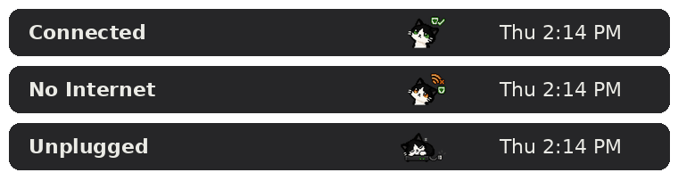
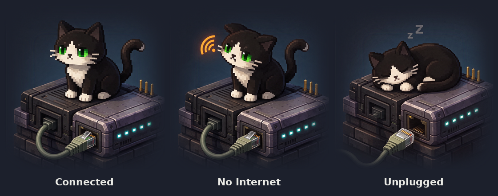

<div align="center">

# LanCat 🐈‍⬛

**A cute cat that lives in your macOS menu bar and shows your Ethernet status at a glance.**

English · [한국어](README.ko.md)



</div>

macOS shows a Wi-Fi icon in the menu bar, but nothing for wired Ethernet.
LanCat fills that gap with a small cat that reacts to your connection.

| State | Menu bar cat | Meaning |
|---|---|---|
| **Connected** | Green eyes + check, blinks now and then | Ethernet linked and the internet is reachable |
| **No Internet** | Orange eyes + Wi-Fi ✕ | Cable is plugged in, but the internet can't be reached |
| **Unplugged** | Sleeping on the router, z… z… | No Ethernet link |

<p align="center"></p>

## Features

- Real-time Ethernet link detection (judged by the wired connection even when Wi-Fi is on)
- Internet check over the Ethernet interface only (every 15 seconds)
- Click the cat for details: interface, link speed, IP, gateway, DNS
- Notifications when the state changes
- **Customize**: replace the menu bar icon and popover image for each state with your own (PNG, JPG, GIF, APNG, WebP)
  - Animated GIFs animate in the menu bar too
  - Automatic margin trimming, white background removal and menu bar sizing
- Launch at login, update notifications
- Languages: English, 한국어, 日本語, 简体中文
- Menu bar only (no Dock icon), uses about 20–30 MB of memory

## Install

1. Download the latest `LanCat.dmg` from [Releases](https://github.com/kiyoungsong/LanCat/releases/latest)
2. Drag `LanCat.app` into your Applications folder
3. LanCat isn't signed with an Apple Developer ID, so macOS may block the first launch. Run this once in Terminal:

   ```bash
   xattr -cr /Applications/LanCat.app
   ```

   Or open **System Settings → Privacy & Security** and click **Open Anyway**.

Requires macOS 13 Ventura or later (Apple Silicon and Intel).

## Usage

- **Left click**: details popover
- **Right click**: Settings… (⌘,) / Preview State (Test) / Quit
- **Settings → Appearance**: pick a state, then drag an image onto the slot. Try the samples in [`test-images/`](test-images)

## Build from source

Requires Xcode or the Command Line Tools (`xcode-select --install`).

```bash
git clone https://github.com/kiyoungsong/LanCat.git
cd LanCat
./build.sh --run          # build and launch build/LanCat.app
./build.sh --dmg          # also create build/LanCat.dmg
UNIVERSAL=1 ./build.sh    # Apple Silicon + Intel (needs Xcode)
```

### Testing "No Internet"

Right click → **Preview State** switches the UI without touching your network.
To reproduce it for real while the cable stays plugged in:

```bash
sudo route add -host 1.1.1.1 127.0.0.1     # block the check
sudo route delete -host 1.1.1.1            # restore
```

## Project structure

```
Sources/LanCat/
  main.swift            App entry (menu bar only)
  AppDelegate.swift     Menu bar icon animation, popover, menu, notifications
  NetworkMonitor.swift  Ethernet detection (NWPathMonitor) + internet check over Ethernet
  PopoverView.swift     SwiftUI popover with per-state animations
  SettingsView.swift    Settings window (General / Appearance)
  ThemeStore.swift      Default and custom images for the 6 slots
  ImageProcessor.swift  Frame decoding, white background removal, trimming, resizing
  UpdateChecker.swift   Checks GitHub Releases for a newer version
  Localization.swift    L("key") helper and app language override
Resources/
  icon_*.png, scene_*.png, AppIcon.png
  {en,ko,ja,zh-Hans}.lproj/Localizable.strings
design/                 Original artwork
test-images/            Sample images for the Appearance settings
```

## Releasing

Push a version tag and GitHub Actions builds a universal app and attaches `LanCat.dmg` to the release.

```bash
git tag v1.0.1
git push origin v1.0.1
```

## Contributing translations

Copy `Resources/en.lproj/Localizable.strings` into a new `<language>.lproj` folder, translate the values, and add the language code to `CFBundleLocalizations` in `build.sh`. Pull requests are welcome!

## License

[MIT](LICENSE) © 2026 Kiyoung Song
